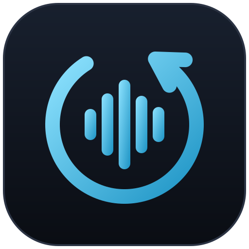
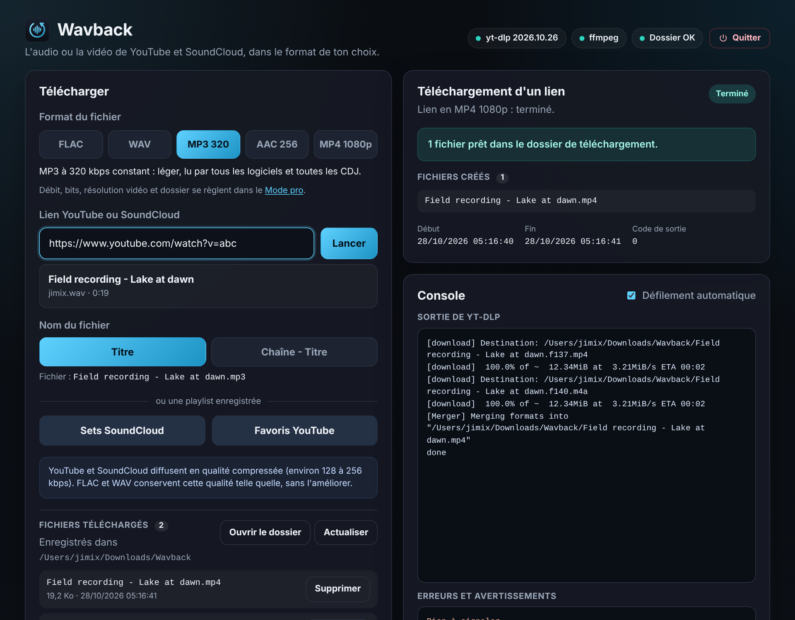

<p align="center">
  
</p>

<h1 align="center">Wavback</h1>

<p align="center">
  <strong>Get your wav back.</strong> Récupère l'audio et la vidéo de tes liens, en FLAC, WAV, MP3 ou MP4. En local.
</p>

<p align="center">
  <a href="https://github.com/JimixWav/Wavback/actions/workflows/ci.yml"></a>
</p>

Wavback est une interface simple, dans ton navigateur, pour récupérer l'audio ou la vidéo de liens YouTube et SoundCloud avec [yt-dlp](https://github.com/yt-dlp/yt-dlp). Tout tourne sur ton ordinateur : rien n'est envoyé ailleurs.



- **Audio** : FLAC, WAV, MP3, AAC (.m4a). Débit, bits et fréquence réglables.
- **Vidéo** : MP4 jusqu'à 1080p, lisible partout (H.264 + AAC). 1440p et 4K disponibles.
- **Aperçu** du titre, de la durée et du nom exact du fichier avant de télécharger.
- **Playlists enregistrées** : un bouton par playlist, chacune avec son style de nom de fichier.
- **Installation automatique** : le lanceur vérifie ce qui est présent et télécharge ce qui manque. Pas de droits administrateur, pas de Python.
- macOS, Windows et Linux (Raspberry Pi compris). Interface en français.

> Utilise cet outil uniquement pour des contenus que tu as le droit de télécharger : tes propres créations, des contenus libres de droits ou dont l'auteur autorise le téléchargement. Respecte les conditions d'utilisation des plateformes.

---

## Installation

1. **Télécharge le projet** : bouton vert **Code** → **Download ZIP**, puis décompresse-le où tu veux (par exemple dans Documents). Ou, si tu utilises Git : `git clone https://github.com/JimixWav/Wavback.git`.
2. **Lance l'application** avec le lanceur de ton système :

| Système | Lanceur | Première ouverture |
|---|---|---|
| macOS | double-clic sur `launch.command` | macOS bloque les fichiers téléchargés : **clic droit → Ouvrir → Ouvrir**. |
| Windows 10 / 11 | double-clic sur `launch_windows.bat` | Si SmartScreen s'affiche : **Informations complémentaires → Exécuter quand même**. |
| Linux, Raspberry Pi | `./launch.sh` dans un terminal | Rien de particulier. |

La première fois, le lanceur télécharge les outils nécessaires (environ 150 Mo, quelques minutes). Les fois suivantes, l'application s'ouvre en quelques secondes dans ton navigateur, à l'adresse `http://localhost:8765/`.

Pour arrêter l'application : bouton **Quitter** en haut à droite, ou ferme la fenêtre du terminal.

### Ce que le lanceur installe

Tout va dans le dossier `bin/` du projet. Rien n'est installé ailleurs sur ton ordinateur : pour tout désinstaller, supprime le dossier.

| Outil | Rôle | Source |
|---|---|---|
| Node.js 22+ | fait tourner l'application | Celui de ton ordinateur s'il est assez récent, sinon une copie portable depuis [nodejs.org](https://nodejs.org) |
| yt-dlp | récupère les médias | [Version officielle autonome](https://github.com/yt-dlp/yt-dlp/releases) |
| FFmpeg | convertit l'audio, assemble les vidéos | Celui de ton ordinateur s'il est installé, sinon une version statique : [Martin Riedl](https://ffmpeg.martin-riedl.de) (macOS), [BtbN](https://github.com/BtbN/FFmpeg-Builds) (Windows), [John Van Sickle](https://johnvansickle.com/ffmpeg/) (Linux) |

Chaque téléchargement est vérifié par sa somme de contrôle quand la source en publie une.

Pour retélécharger les outils (en cas de problème) : `bash scripts/install.sh --force` sur macOS et Linux, ou `powershell -ExecutionPolicy Bypass -File scripts\install.ps1 -Force` sur Windows.

---

## Utilisation

1. Choisis le **format** : FLAC, WAV, MP3, AAC ou MP4.
2. Colle un **lien** YouTube ou SoundCloud. L'aperçu affiche le titre et le nom du fichier.
3. Clique sur **Lancer**. La progression s'affiche à droite.

Les fichiers arrivent dans `Téléchargements/Wavback`. Le bouton **Ouvrir le dossier** l'affiche dans le Finder ou l'Explorateur.

Le **Mode pro** (dans « Réglages et diagnostic ») permet de régler :
- les débits MP3 et AAC, les bits du FLAC et du WAV, la fréquence d'échantillonnage ;
- la résolution maximale des vidéos ;
- le dossier de téléchargement ;
- jusqu'à 10 playlists enregistrées.

### Quand YouTube ne fonctionne plus

YouTube change souvent son fonctionnement. Si les téléchargements échouent sans raison claire, clique sur **Mettre à jour yt-dlp** (dans « Réglages et diagnostic »). C'est la solution dans la grande majorité des cas.

Le message « Sign in to confirm you're not a bot » apparaît surtout derrière un VPN ou sur un serveur dans un datacenter : YouTube se méfie de ces adresses IP. Désactive le VPN, ou utilise une connexion internet classique.

### Mettre à jour l'application

Avec Git : `git pull`. Sinon, télécharge le nouveau ZIP et copie dedans ton `settings.json` (tes réglages) et, si tu en as un, ton `config.json`. Le dossier `bin/` peut aussi être recopié pour éviter de retélécharger les outils.

---

## Utilisation depuis un autre appareil (Raspberry Pi, serveur maison)

Par défaut, l'application n'accepte que les connexions venant de l'ordinateur qui la fait tourner. Pour l'utiliser depuis ton téléphone ou un autre ordinateur du réseau, par exemple avec un Raspberry Pi allumé en permanence :

1. Copie `config.example.json` en `config.json`.
2. Modifie-le :
   ```json
   "app": { "host": "0.0.0.0", "port": 8765, "open_browser": false },
   "auth": { "user": "admin", "password": "un-mot-de-passe-solide" },
   "cleanup": { "max_age_minutes": 1440, "interval_minutes": 10 }
   ```
3. Relance avec `./launch.sh`, puis ouvre `http://<adresse-du-pi>:8765/` depuis l'autre appareil.

Depuis un autre appareil, un mot de passe est demandé et les fichiers se récupèrent avec le bouton **Télécharger** de la liste. `cleanup.max_age_minutes` supprime automatiquement les fichiers créés par l'application après ce délai (24 h dans l'exemple). Les autres fichiers du dossier ne sont jamais touchés.

Raspberry Pi pris en charge : Pi 3, 4 et 5 avec Raspberry Pi OS 64 bits (recommandé). Avec un système 32 bits, yt-dlp a besoin de Python 3.10 ou plus récent, déjà présent sur Raspberry Pi OS récent.

N'expose pas l'application directement sur Internet (redirection de port sur ta box) : elle est pensée pour un réseau domestique.

---

## Configuration (`config.json`)

Facultatif : sans ce fichier, les valeurs de `config.example.json` s'appliquent. Les réglages faits dans le Mode pro sont enregistrés à part, dans `settings.json`.

| Clé | Rôle | Défaut |
|---|---|---|
| `app.host` | `127.0.0.1` : cet ordinateur seulement. `0.0.0.0` : tout le réseau local | `127.0.0.1` |
| `app.port` | Port de l'interface | `8765` |
| `app.open_browser` | Ouvre le navigateur au lancement | `true` |
| `auth.user`, `auth.password` | Identifiants demandés aux autres appareils (sans mot de passe, ils sont refusés) | `admin`, vide |
| `downloads.dir` | Dossier de téléchargement par défaut | `~/Downloads/Wavback` |
| `downloads.default_format` | `flac`, `wav`, `mp3`, `m4a` ou `mp4` | `mp3` |
| `downloads.max_filesize` | Taille maximale d'un fichier, par exemple `2G` (vide : illimitée) | vide |
| `downloads.youtube_playlist_url`, `soundcloud_playlist_url` | Playlists proposées à la première ouverture | vide |
| `cleanup.max_age_minutes` | Supprime les fichiers créés par l'application après ce délai (0 : jamais) | `0` |
| `executables.yt_dlp` | Chemin de yt-dlp (celui du PATH s'il n'existe pas) | `bin/yt-dlp` |
| `executables.ffmpeg_location` | Dossier de ffmpeg et ffprobe (ceux du PATH s'il n'existe pas) | `bin/ffmpeg` |
| `executables.js_runtime` | Moteur JavaScript passé à yt-dlp pour YouTube : `node` (celui de l'application), `deno`, ou vide | `node` |

---

## Sécurité

- Les liens acceptés sont uniquement YouTube et SoundCloud, vérifiés côté serveur.
- yt-dlp est lancé sans shell, avec des options fixées par l'application : l'interface ne peut pas lui passer d'option libre.
- Les actions qui modifient quelque chose refusent les requêtes venant d'un autre site ouvert dans le même navigateur.
- Ouvrir le dossier, choisir le dossier et Quitter ne fonctionnent que sur l'ordinateur qui fait tourner l'application.

---

## Développement

Aucune dépendance npm : Node.js 22 ou plus récent suffit.

```bash
npm start   # lance le serveur (yt-dlp et FFmpeg : ceux de bin/ ou du PATH)
npm test    # tests unitaires et de bout en bout (avec un faux yt-dlp, sans réseau)
```

```text
server.js                 serveur HTTP, accès, routes
src/downloader.js         lance yt-dlp et suit la tâche
src/preview.js            aperçu d'un lien
src/formats.js            options yt-dlp par format
src/files.js              liste, téléchargement et suppression des fichiers
src/cleanup.js            suppression automatique (optionnelle)
src/settings-store.js     réglages du Mode pro
src/system.js             ouvrir le navigateur ou un dossier, choisir un dossier
public/                   l'interface (HTML, CSS et JavaScript sans framework)
scripts/install.sh        installateur macOS et Linux
scripts/install.ps1       installateur Windows
```

La CI GitHub Actions lance les tests sur les trois systèmes et exécute le vrai installateur à chaque push.

---

## English

**Wavback** is a local web interface for [yt-dlp](https://github.com/yt-dlp/yt-dlp): paste a YouTube or SoundCloud link, pick FLAC, WAV, MP3, AAC or MP4, and get the file in your Downloads folder. Download the ZIP, then double-click `launch.command` (macOS) or `launch_windows.bat` (Windows), or run `./launch.sh` (Linux). On first run it fetches Node.js (if needed), yt-dlp and FFmpeg into `bin/`, with no admin rights and no Python. The interface is in French. Only download content you have the right to download.

---

## Licence

[MIT](LICENSE) © 2026 jimix.wav · [github.com/JimixWav](https://github.com/JimixWav)

yt-dlp est distribué sous licence [Unlicense](https://github.com/yt-dlp/yt-dlp/blob/master/LICENSE), FFmpeg sous licence [GPL/LGPL](https://ffmpeg.org/legal.html). Ils sont téléchargés depuis leurs sources officielles au premier lancement et ne sont pas inclus dans ce dépôt.
